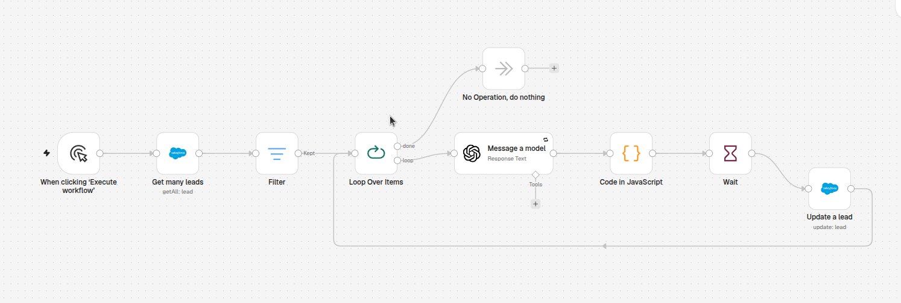
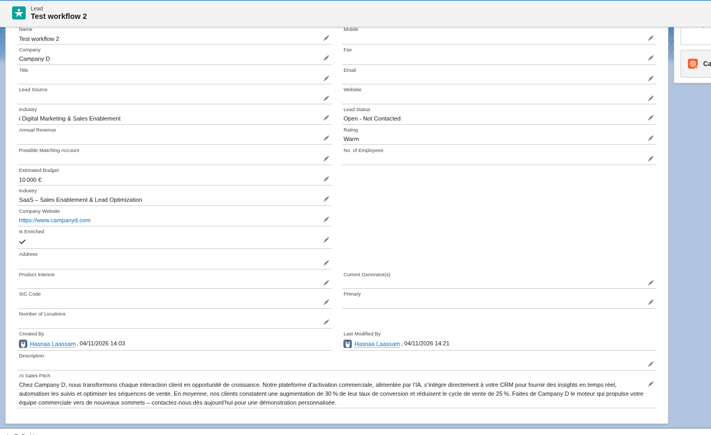
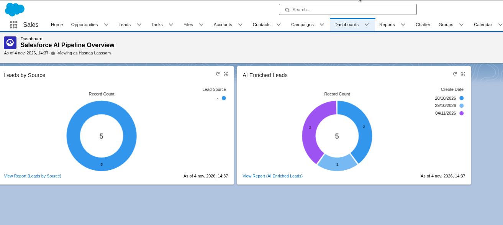

# 🚀 Salesforce AI Enrichment Pipeline

## 📖 Contexte métier
Les équipes commerciales des PME passent un temps considérable à rechercher manuellement des informations sur les leads entrants (secteur d'activité, site web, etc.) avant de pouvoir les qualifier et les contacter. Ce processus est lent, fastidieux et source d'erreurs.

## 💡 La solution
J'ai conçu et développé un pipeline d'enrichissement automatisé (ETL) qui connecte **Salesforce**, **n8n** et un modèle d'IA générative (**API Groq / Llama 3**). 

Le système s'exécute automatiquement à intervalles réguliers (Schedule Trigger) pour :
1. **Extraire** les leads non enrichis (`Is Enriched = false`) et non convertis (`IsConverted = false`) depuis Salesforce.
2. **Envoyer** le nom de l'entreprise à l'IA pour obtenir son secteur d'activité, son site web et générer un pitch de vente personnalisé.
3. **Nettoyer et Parser** la réponse JSON de l'IA via un script JavaScript.
4. **Mettre à jour** automatiquement les champs du Lead dans Salesforce et le marquer comme traité.

## 🛠️ Stack technique
*   **CRM** : Salesforce (API REST, OAuth 2.0, SOQL)
*   **Orchestration** : n8n (Schedule Trigger, Traitement par lots / Batch Processing)
*   **Intelligence Artificielle** : Groq API (Modèle Llama 3 / GPT-OSS)
*   **Langage** : JavaScript (pour le parsing et la gestion des données)

## 🏗️ Architecture du Workflow
Le workflow est conçu pour être résilient, automatique et respecter les limites d'API (Governor Limits).

   

### 💡 Points techniques clés (Points forts pour les recruteurs) :
*   **Traitement par lots (Batch Processing)** : Utilisation d'une boucle (`Loop Over Items`) couplée à une limite (`Limit = 10`) sur la requête Salesforce pour traiter les leads par paquets, évitant de surcharger l'API.
*   **Gestion du Rate Limiting** : Intégration d'un nœud `Wait` (5 secondes) dans la boucle pour respecter les limites de tokens par minute (TPM) de l'API IA gratuite.
*   **Gestion des cas limites (Edge Cases)** : Le workflow exclut automatiquement les leads déjà convertis (qui sont en lecture seule dans Salesforce) pour éviter les erreurs de mise à jour.
*   **Data Cleansing** : Un nœud `Code (JavaScript)` nettoie les balises Markdown renvoyées par l'IA et transforme le texte brut en un objet JSON exploitable.
*   **Automatisation complète** : Déclenchement planifié (Schedule Trigger) pour une exécution autonome.

## 📸 Démonstration

### 1. Les Données enrichies dans Salesforce
Les champs `Industry`, `Company Website`, et `AI Sales Pitch` sont automatiquement remplis, et le champ `Is Enriched` passe à `True`.

   

### 2. Le Dashboard de suivi (Business Value)
Ce dashboard permet aux équipes commerciales de visualiser l'impact de l'automatisation sur la qualité des leads et le volume de leads traités par l'IA.

   

## 🚀 Comment importer et utiliser ce workflow
1. Téléchargez le fichier `salesforce-ai-enrichment-pipeline.json` présent dans ce dépôt.
2. Dans votre instance n8n, cliquez sur `Import from File` et sélectionnez le fichier.
3. Configurez vos identifiants :
   *   **Salesforce** : Ajoutez vos identifiants OAuth (Client ID, Client Secret).
   *   **IA** : Ajoutez votre clé API Groq (ou OpenAI).
4. Ajustez les limites (`Get Many`) et les temps d'attente (`Wait`) selon votre utilisation.
5. Activez le workflow (Publish).